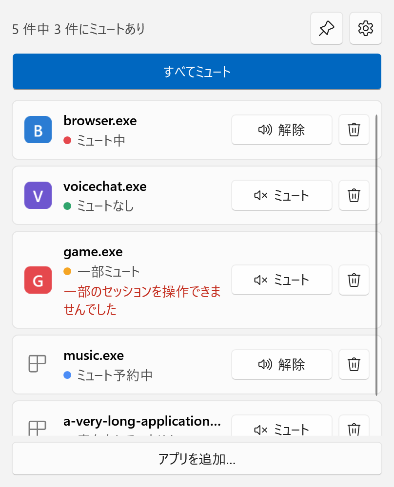
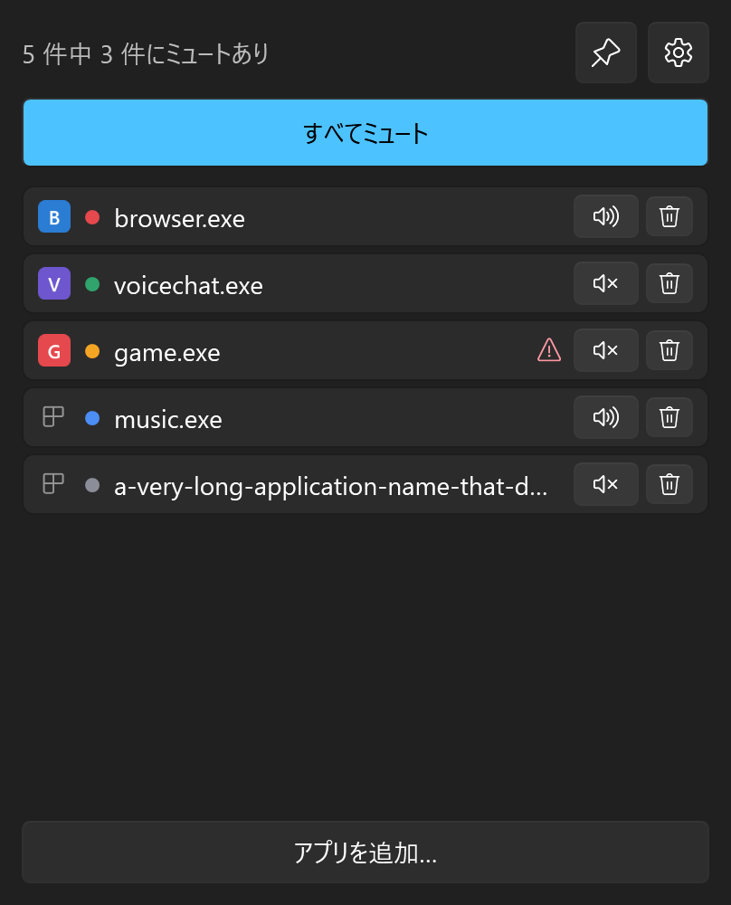
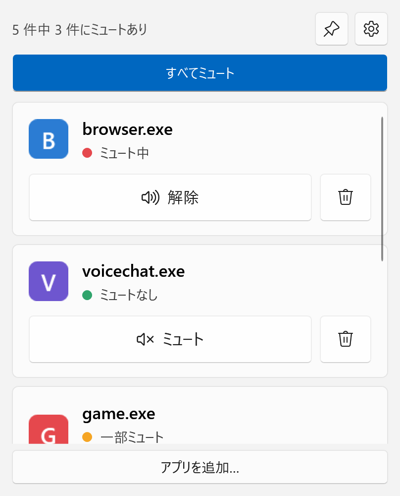
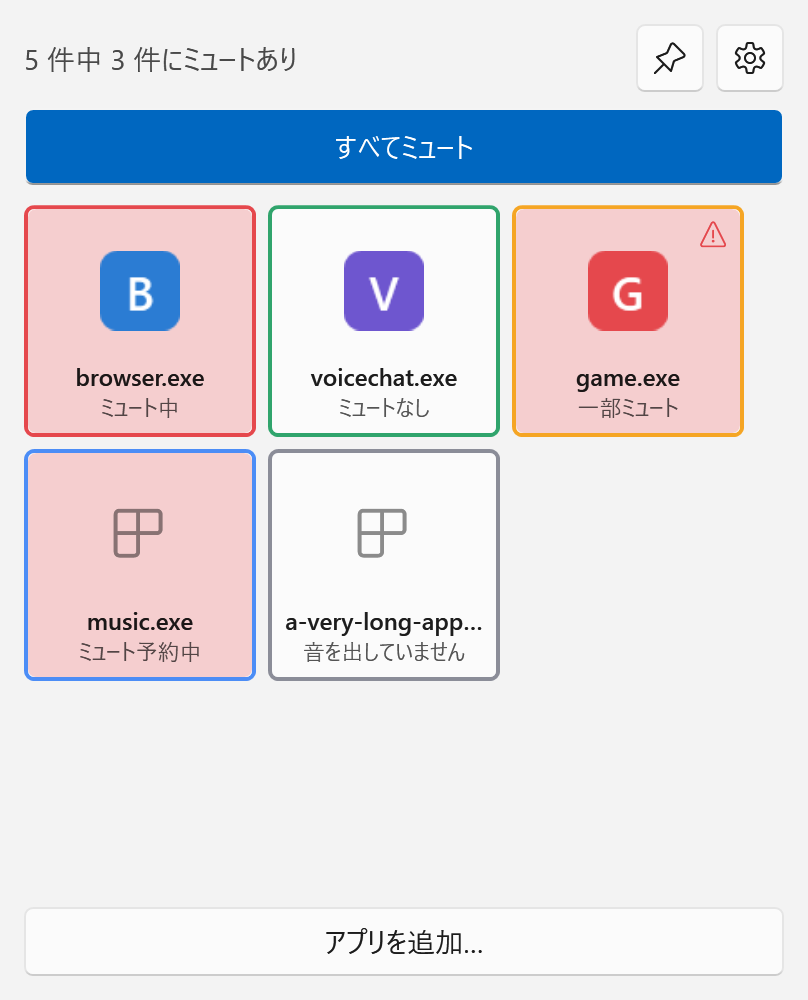
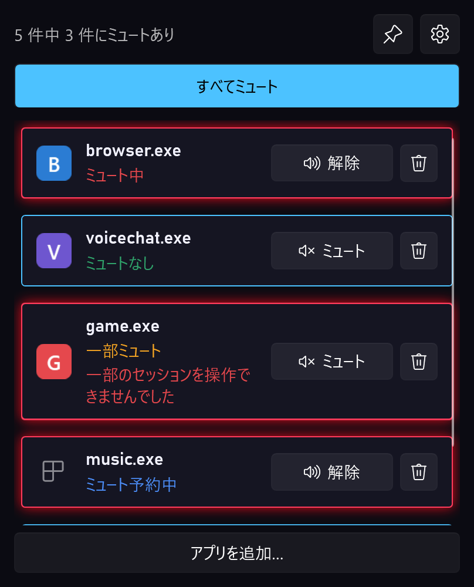
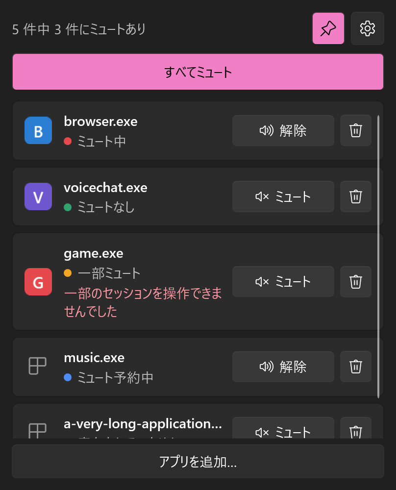
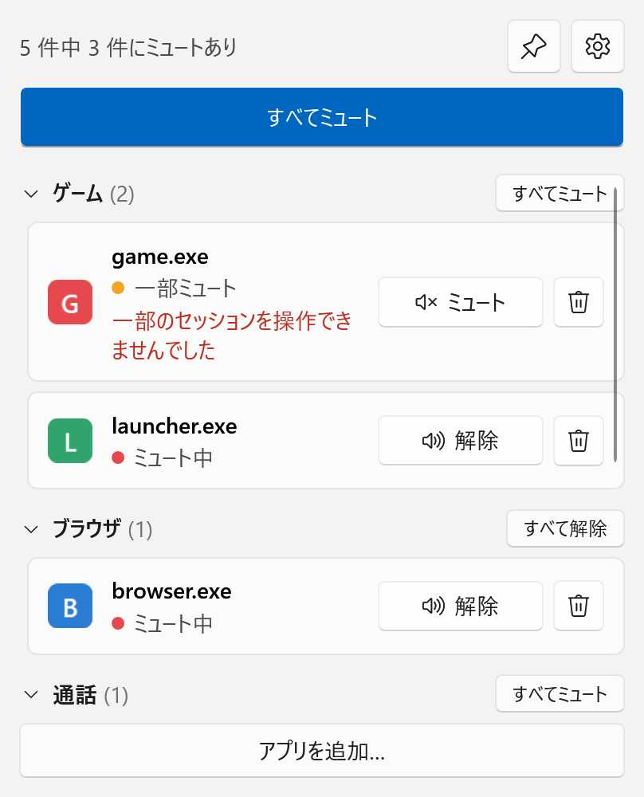

# HushSwitch

指定したアプリの音だけを、ボタン 1 つでミュート/解除する Windows 用のソフトです。
通話中にブラウザの音だけ消す、ゲーム中に音楽アプリだけ消す、といった場面で、音量ミキサーを開かずに切り替えられます。


## できること

- 登録したアプリ(exe 名)ごとに、ミュートと解除を 1 回のクリックで切り替える
- 登録したアプリをまとめて切り替える(「すべてミュート」/「すべて解除」)
- アプリが複数のプロセスや、既定でない再生デバイスで音を出していても、全部まとめて切り替える
- まだ音を出していないアプリを「ミュート予約」しておき、鳴り始めたらすぐミュートする(Windows からの通知を受けて動きます)
- Windows の音量ミキサーなどで変えた結果も、1 秒ほどで表示に反映する
- ウィンドウを閉じてもトレイに残り、トレイのメニューやホットキー(どの画面にいても効くキー)でまとめて切り替える
- 設定の画面で、デザイン(標準 / コンパクト / 大きめ / タイル / ゲーミング)、配色(Windows に合わせる / ライト / ダーク)、アクセントの色、文字の大きさ、ウィンドウの不透明度、表示する物(アイコン・状態・件数・削除ボタン)、常に手前に表示、× を押したときの動作、終了時の動作、ホットキー、Windows の起動時の自動起動を変える
- アプリをカテゴリー(ゲーム・ブラウザ・通話・音楽など。名前は自由に変えられる)に分け、見出しごとに畳んだり、まとめて切り替えたりする。カテゴリーごとのホットキーも決められる
- 操作の記録をログに残す

## デザイン

設定の「デザイン」で切り替えます。

| 標準 | コンパクト | 大きめ |
|---|---|---|
|  |  |  |

| タイル | ゲーミング | アクセントの色(ピンク) |
|---|---|---|
|  |  |  |

- タイルは、タイルを押すと切り替わります。削除は右クリックから
- ゲーミングは暗い配色で固定です
- カテゴリーに分けると、見出しが付きます(下の画像)。アプリをカテゴリーに入れるには、一覧の行を右クリックします



- 削除のボタンを隠しても、行の右クリックから削除できます

## 仕組みと、やらないこと

Windows の音量ミキサーと同じ公開 API(Core Audio のセッションのミュート)だけを使います。

- 対象アプリのプロセスには触れません(メモリの読み書き・DLL の注入・フックをしません)
- 一覧に出すアプリのアイコンは、exe のファイルから読みます。exe の場所は Windows が音のセッションに付けている情報から分かるので、ここでもプロセスには触れません。読んだアイコンの写しを `%LOCALAPPDATA%\HushSwitch\icons\` に置きます(exe の場所そのものは保存しません)
- ホットキーは、キーの組み合わせを Windows に登録する仕組みを使います。キー入力の監視はしません
- 音量、既定のデバイス、アプリの出力先は変えません
- 管理者権限は要りません。ネットワークには接続しません
- 自動起動を選んだときだけ、自分のユーザーの起動項目(レジストリ)に 1 行足します。チェックを外すと消します
- 設定ファイルとログに書くアプリの情報は、exe のファイル名だけです(ウィンドウのタイトルやフルパスは書きません)

## 動作環境

- Windows 11(64 ビット)で確認しています。Windows 10 は未確認です

## ダウンロード

[Releases](https://github.com/takosasi-dev/hush-switch/releases) から `HushSwitch-vX.Y.Z-win-x64.exe` をダウンロードして、そのまま起動します。
インストールも .NET の導入も要りません(ランタイムを同梱しているので、ファイルは 170 MB ほどあります)。

## 使い方

1. 「アプリを追加…」を押し、「音を出しているアプリ」の一覧から選んで「追加」を押します。一覧に無いアプリは「exe ファイルを選ぶ…」から登録できます
2. 行の「ミュート」を押すと、そのアプリの音だけが消えます。もう一度押すと戻ります
3. 上の「すべてミュート」で、登録したアプリをまとめて切り替えます
4. ウィンドウの × を押すと、終了せずにトレイ(画面右下)に格納されます。トレイのアイコンを押すと戻り、右クリックのメニューから終了できます。ミュートしているアプリがあるあいだ、トレイのアイコンは赤になります
5. 右上の歯車で設定の画面が開きます。ピンのボタンは「常に手前に表示」です

行の表示は次の 5 つです。

| 表示 | 意味 |
|---|---|
| ミュート中 | そのアプリの音が全部ミュートされている |
| 一部ミュート | 一部だけミュートされている(音量ミキサーで個別に変えたとき等) |
| ミュートなし | 音を出していて、ミュートされていない |
| ミュート予約中 | 今は音を出していない。鳴り始めたらミュートする |
| 音を出していません | 今は音を出していない。予約もしていない |

## 知っておくこと(v0.3.0)

- **終了してもミュートは残ります**(Windows がアプリごとに覚えています)。ミュートが残っている状態で終了しようとすると、「解除して終了」か「このまま終了」かを聞きます。残ってしまったら、もう一度起動して「解除」を押すか、Windows の音量ミキサーで解除します
- ホットキーに決めたキーは、ほかのアプリでは使えなくなります。使えるのは Ctrl か Alt を含む組み合わせか、F1〜F24 です
- 自動起動は、そのときの exe の場所で登録します。exe を別のフォルダへ移したら、設定でチェックを入れ直してください
- 配色が「Windows に合わせる」のまま Windows のライト/ダークを切り替えると、選んだアクセントの色の濃さがずれることがあります。設定の画面を開いて閉じると直ります
- アプリのアイコンは、そのアプリが一度音を出すと出るようになります。それまでは共通の絵です(ストアのアプリなど、読めないものもあります)
- ミュート予約中のアプリが鳴り始めた瞬間に、ごく短く音が出ることがあります。通知が届かなかった場合は、1 秒ごとの確認でミュートします
- Windows のオーディオサービスに接続できないときは、上部に「オーディオサービスに接続できません。再試行しています」と出して、つながるまで 1 秒ごとに試します(v0.2.0 には、オーディオサービスを止めてもこの表示が出ない不具合がありました)
- ブラウザの特定のタブだけ、のような切り替えはできません(アプリ単位です)
- 登録できるのは 20 件までです
- 設定は `%APPDATA%\HushSwitch\settings.json` に保存します(ミュートの状態は保存しません)
- ログは `%LOCALAPPDATA%\HushSwitch\logs\` に 1 行 1 件の JSON で残します。1 ファイル 5 MB までで、14 日たったファイルは起動時に消します

## ソースからビルドする

[.NET 10 SDK](https://dotnet.microsoft.com/download) が要ります。

```
dotnet build HushSwitch.slnx
dotnet run --project tests/HushSwitch.Tests
dotnet publish src/HushSwitch -c Release -r win-x64 -p:SelfContained=true -o dist
```

| フォルダ | 中身 |
|---|---|
| `src/HushSwitch.Core` | Core Audio の列挙とミュート、状態の規則、設定ファイル |
| `src/HushSwitch` | 画面(WPF) |
| `tests/HushSwitch.Tests` | 自動テスト(偽の Core Audio を差し込んで規則を確かめる。窓も音も出しません) |
| `tools/HushSwitch.Probe` | 開発用のコンソール(セッションの一覧表示など。配布物には含めません) |
| `tools/make_icon.cs` | アイコン(`src/HushSwitch/app.ico`)を描いて作る。`dotnet run tools/make_icon.cs` |
| `tools/shoot_ui.cs` | 画面の見た目を、ウィンドウを出さずに PNG に描く。`dotnet run tools/shoot_ui.cs -- <出力フォルダ>` |

ソースのコメントにある `§9.4`・`FR-6`・`INV-1`・`AC-19` などは、公開していない仕様書の番号です。

## 開発状況

作業中です。ひととおりの機能は入りました。これから、ふだん使いで 2 週間ほど動かして様子を見ます。

v0.3.0 は、自動テスト(偽の Core Audio を使う)と、ウィンドウを出さずに描いた画面の画像でだけ確かめています。実際のウィンドウでの次の動きは、まだ確かめていません。

- トレイへの格納と、終了するときの確認
- 設定を変えたときに、開いている画面へすぐ反映されるか(デザイン・配色・アクセントの色・文字の大きさ・表示する物)
- ウィンドウの不透明度
- カテゴリーの振り分け・畳む・まとめての切り替え、トレイのメニューのカテゴリーの項目
- ホットキー(ほかのアプリが同じキーを使っているときを含む)
- 自動起動と、ウィンドウの位置・大きさの復元
- オーディオサービスを止めたときの表示と再接続、再生デバイスの抜き差し、スリープからの復帰

## ライセンス

[MIT](LICENSE)。配布している exe には [NAudio](https://github.com/naudio/NAudio)(MIT)と .NET ランタイム(MIT)を同梱しています。
